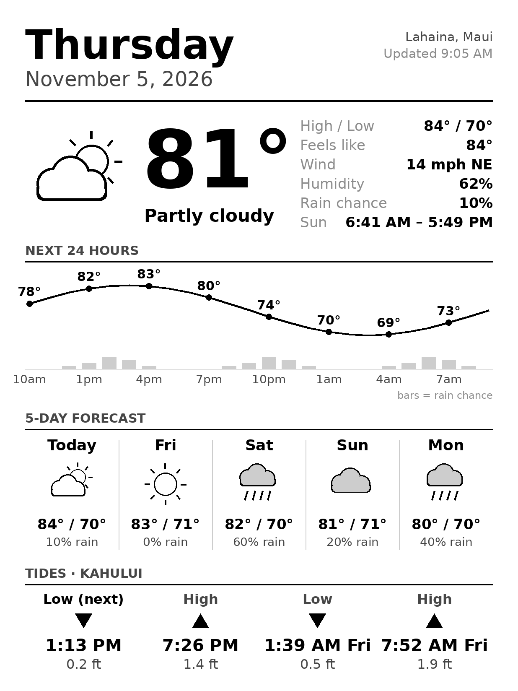

# Kindle Dashboard

An always-on e-ink dashboard for Maui: weather, a 24-hour temperature and rain chart, a 5-day forecast, and tides. A Raspberry Pi builds the image and a jailbroken Kindle Paperwhite shows it on the wall.



## How it works

```
Open-Meteo (weather) ─┐
                      ├─► Raspberry Pi 3 ── builds dashboard.png every 15 min ── serves it on :8080
NOAA (tides) ─────────┘                                                              │
                                                     Kindle Paperwhite 5 ◄── downloads & displays
```

- **Light on purpose.** The Pi also runs Pi-hole and has 1GB of RAM, so the image is drawn directly with Python + Pillow. No headless browser.
- **Free data, no API keys.** [Open-Meteo](https://open-meteo.com/) for weather, [NOAA CO-OPS](https://tidesandcurrents.noaa.gov/) for tides.
- **Fails gracefully.** If one source is down, the rest still draws and a note appears at the bottom.

## Hardware

| Part | Model |
|---|---|
| Server | Raspberry Pi 3 Model B+, Raspberry Pi OS Lite 64-bit |
| Display | Kindle Paperwhite 5 (11th gen, M2L3EK), 1236 × 1648 |

## Pi setup

SSH into the Pi, then:

```bash
sudo apt update
sudo apt install -y git python3-pil python3-requests fonts-dejavu-core
git clone https://github.com/Napili808/kindle-dashboard.git
cd kindle-dashboard
cp config.example.toml config.toml        # edit location / tide station if you like
python3 make_dashboard.py                 # should print "Wrote .../output/dashboard.png"
```

Run it on a schedule and serve the image:

```bash
# If your Pi username isn't "minh", edit User= and the paths in pi/*.service first.
sudo cp pi/kindle-dashboard.service pi/kindle-dashboard.timer pi/kindle-dashboard-web.service /etc/systemd/system/
sudo systemctl daemon-reload
sudo systemctl enable --now kindle-dashboard.timer kindle-dashboard-web.service
```

Check it from any device on your Wi-Fi: `http://<pi-ip>:8080/dashboard.png`

Get updates later:

```bash
cd ~/kindle-dashboard && git pull
```

## Kindle setup (experimental)

1. **Check firmware first** (Settings → Device Options → Device Info) with Wi-Fi off, so it can't auto-update.
2. Jailbreak with a method that supports your firmware (see [kindlemodding.org](https://kindlemodding.org/)), and install KUAL.
3. Copy `kindle/dashboard.sh` to the Kindle, set `PI_URL` to your Pi's address, and launch it.

To exit dashboard mode, hold the power button until the Kindle restarts.

## Try it without any hardware

```bash
pip install -r requirements.txt
python3 make_dashboard.py --sample      # made-up data, no internet needed
```

## Roadmap

- [ ] Google Calendar events (via private iCal link in `config.toml`)
- [ ] Surf / wind conditions for OC6 paddling
- [ ] Kindle script tested on real hardware
- [ ] Night mode (lighter refresh schedule overnight)
